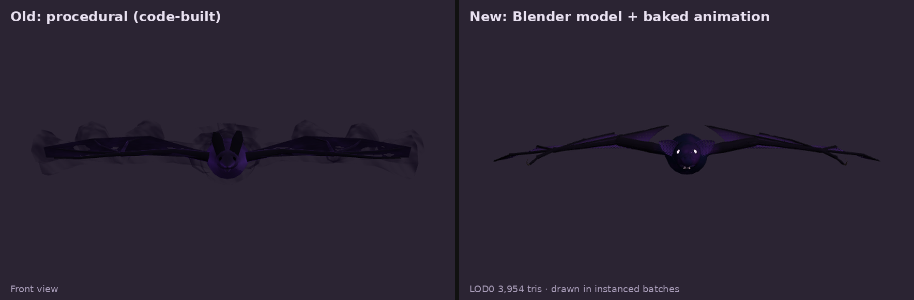
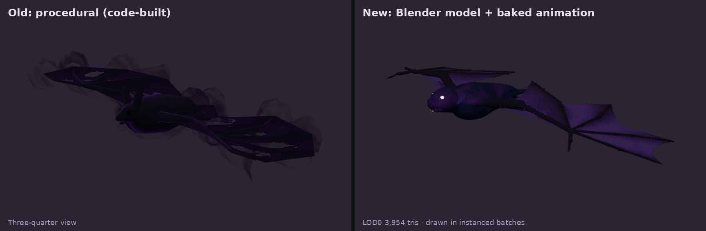
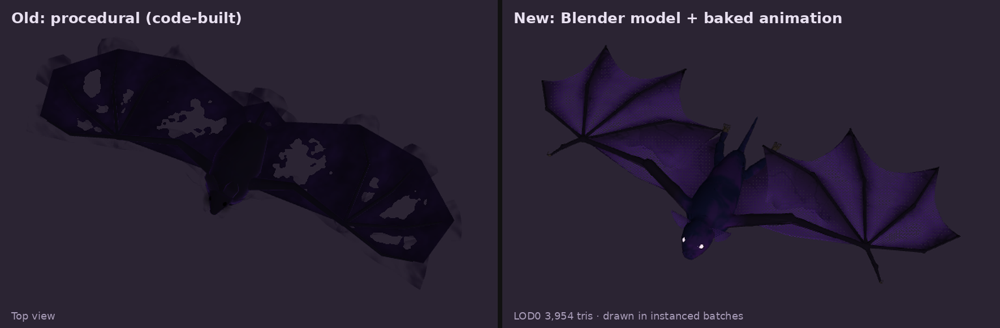

# Creature pipeline: Blender → game (from the Nocturian bat, Nov 2026)

Target: FFX / FFX-remake quality. A believable anatomy on a modest triangle budget, with the detail living in baked textures.
Order: **realism pass** (real anatomy and materials, from reference photos) → **fantasy pass** (shader effects in game).

## Files
- `art/blender/<creature>.blend` is the source. It holds the rig, the detailed model, the game LODs, the actions, and the `sculpt_kit.py` text block.
- `data/creatures/<creature>/`: `<creature>.json` + `.bin` (LODs + baked animation), `color.png`, `normal.png`.
- Game renderer: `src/game/batVat.js` (the Nocturian swarm). Copy it for other instanced creatures.

## Blender steps (all scripted through the MCP add-on)
1. **Rig first**, with bones named like the game's chains (`spine:0`, `arm:1.L`, …), so game motion code and hit zones still match.
2. **One continuous body.** Metaballs or lofted profiles along the bones, fused, never separate primitives glued together (that is what made v1 look toy-like).
   - Metaball surfaces sit at ~0.66× radius (threshold 0.18, stiffness 1): multiply radii by 1.52.
   - Torso and head come from dense lofted profiles (side + top silhouette), not a few big blobs.
3. **Voxel-remesh** (~0.003 m) before sculpting, so the mesh has an even grid that brushes can work on.
4. **Sculpt with `sculpt_kit.py`** (`exec(bpy.data.texts['sculpt_kit.py'].as_string()); k = Kit(obj)`): `draw`, `pinch`, `flatten`, `smooth`, `stroke`, `surface`.
   - Brush radius ≥ 2.5× the mesh spacing, or creases crumple.
   - Do big forms first (sockets, brow, cheekbones, muscles), then lines (mouth, rims), then wrinkles.
   - Thin parts (ears, membranes, claws, teeth, eyes) are separate meshes seated against the sculpted surface.
5. **Materials:** procedural (fur pattern, veins via ridged noise, skin grain as a bump). Check them in Material Preview: Solid view ignores transparency.
6. **Game mesh:**
   - Decimate each part (body ~2.6k, wings ~560, ears ~140, feet ~340 tris), join, one Smart-UV atlas.
   - A `part` colour attribute: R = membrane amount (0 on a bone → 1 between bones), G = eye glow.
   - Weights: the two nearest bone segments (inverse distance⁴), with head and jaw overrides.
7. **Bake** (Cycles, selected → active, cage 0.012): DIFFUSE colour and tangent NORMAL at 2048. Each takes ~10 s on the GPU.
8. **Animate:** 24-frame cycles keyed on the game bones (Blender 5 actions: fcurves live in `layers → strips → channelbags`).
9. **LODs** by decimating LOD0 (0.4, 0.15).
10. **Export the VAT:**
    - Split vertices per (vertex, UV), and convert Blender (x, y, z) → game (x, z, −y).
    - Write positions as float16 and normals as int8, per frame and per animation, into the `.bin`, with a `.json` header.
    - Don't use glTF for VAT data: exporters can reorder vertices, which breaks the vertex-to-animation mapping.

## Bones-only creatures
Creatures drawn by a VAT renderer are built with `buildCreature(THREE, spec, { bonesOnly: true })`: no meshes or materials, just the bone frame. Moves, hit zones, hitboxes and projectile origins still use it. Idle bats aren't posed at all; the frame is moved along with them every 4th frame so hit zones stay right.

## Game renderer (batVat.js)
- **Bestiary:** `createBatShowcase(THREE, data)` gives one flapping bat; play.js `renderBeast` uses it for `nocturianBat` once the model has loaded.
- **Instancing:** one `InstancedMesh` per 20 m cell per LOD (frustum culling per cell). LOD by camera distance (22 m / 55 m).
- **Animation on the GPU:** the vertex shader reads its position and normal from DataTextures (width = vertices, height = frames), interpolates between frames, and blends hover → cruise.
- **Per-instance data** (`iAnim`): phase (advanced on the CPU, so speed changes never pop), animation blend, and a noise offset.
- **Fantasy look, shader only:** membranes dissolve with a stable 4×4 Bayer dither (no sorting, swarm-safe); eyes glow (emissive × part G).
- **Fallback:** `batInstancing.js` keeps the old proxy until the model has loaded, and falls back to it if loading fails.
- **Size:** the model matches the spec at its built size (Nocturian: size param 1.6, now the default). Instances scale by `sizeK / 1.6`.

## Nocturian bat numbers
| | LOD0 | LOD1 | LOD2 |
|---|---|---|---|
| Triangles | 3,954 | 1,580 | 592 |
| GPU vertices | 4,596 | 2,154 | 1,003 |

Animations: hover and cruise (24 frames each). Data: 3.85 MB plus two 2048² textures. Test: 43 bats in 18 draw calls (swiftshader).

## Not done yet
- **Attacks:** `swoop` and `screech` are baked as VAT moves (36 frames each). While a move plays, the shader blends from the wingbeat into the move at `mo.action.u` (`iMove` = move id, progress), and the instance rides the bone frame's `spine:0` (`followBone`), so the flight path and hit timing stay the game's. Dying bats are drawn the same way (the frame falls and shrinks).
- **Fur shell:** the optional fur layer for the nearest bats hasn't been added.

## Before and after (Nocturian bat)
Old procedural model (left) and the Blender model (right), same bestiary lighting:

300 bats: 40–65 fps before, 120–144 fps after (user test, Nov 2026).
